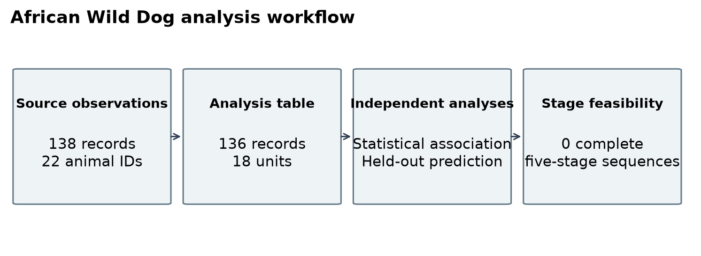
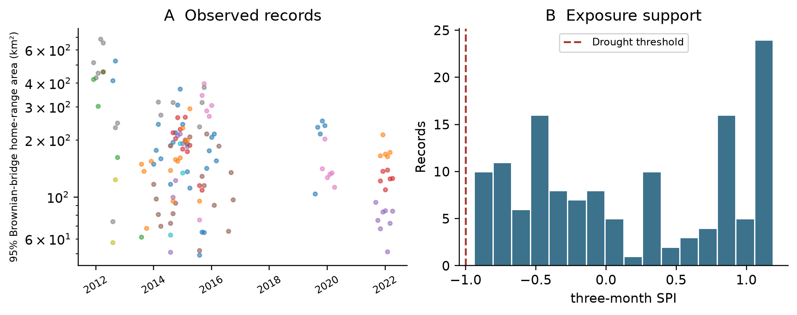
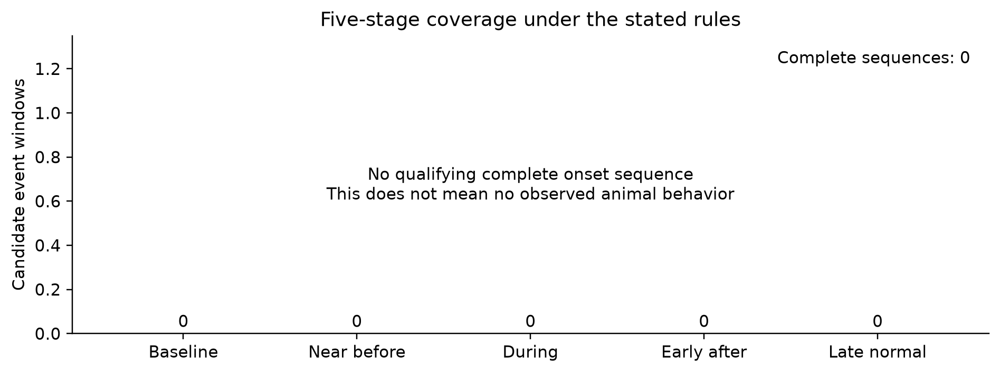
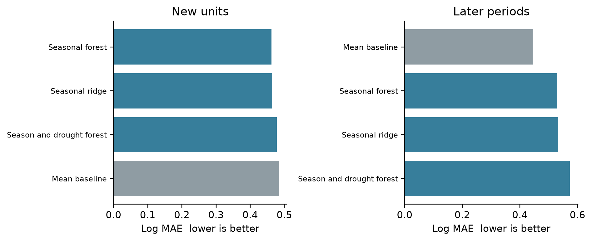

# Dryness and pack space use in African wild dogs

A separate statistical and machine learning analysis of open animal records

Expanded manuscript version 2 | 22 November 2026 | Exploratory secondary analysis

A positive continuous dryness association is suggestive, but the species-specific three-month exposure range does not cross the selected drought threshold. A five-stage disaster response is not observed in this table.

## Abstract

Objective: Does pack-associated home-range area vary with rainfall deficit, and does the available tracking series support observed drought and recovery stages? Data: 22 animal identifiers contributed 138 source observations; the final analysis used 136 records from 18 analytical units. Methods: separate log-scale statistical models and fixed-parameter random forests were evaluated with explicit seasonal controls, group-held-out validation and forward-time validation. An independent coverage screen assessed baseline, near-before, during, early-after and late environmental normalization. Results: The primary estimate was +25.5% in home-range area per one-unit lower three-month SPI, with a nominal uncertainty interval of +2.7% to +53.3% and a multiplicity-adjusted value of q = 0.084. The five-stage screen identified 0 complete animal-level sequences. The lowest log-MAE on unseen units was 0.462; the lowest later-period log-MAE was 0.444. These rankings are descriptive validation results, not tests of model superiority. Conclusion: A positive continuous dryness association is suggestive, but the species-specific three-month exposure range does not cross the selected drought threshold. A five-stage disaster response is not observed in this table. Neither predictive performance nor a period contrast alone establishes drought causation or disaster anticipation.

Keywords: Lycaon pictus; drought; animal movement; home range; seasonal confounding; random forest; grouped validation

## 1 Introduction

This study examines records for the African wild dog using openly deposited observations from Botswana predator study. Its purpose is to determine what the available records can support, rather than assume that every apparent temporal change is a response to a disaster. The scientific object is a recorded behavioral measure, not a direct measure of physiological stress, survival, motivation or disaster perception. Those distinctions constrain the interpretation of every subsequent result.

A five-stage framework can be useful for organizing questions about onset and recovery. It can also create misleading certainty if stages are assigned from a calendar alone or if the same outcome is used to define recovery and then test it. Here, stage rules are specified from environmental exposure and observation coverage. A missing stage remains missing. Repeated rows from one animal or one shared climate event are not interpreted as independent replications.

Three questions guide the analysis. First, how much behavioral variation is associated with observed dryness or the available period labels after the controls supported by the data? Second, do nonlinear models predict held-out observations better than simple baselines? Third, does the sampling structure permit all five requested stages to be compared? These questions have different targets. A model that predicts behavior can succeed without identifying a causal drought effect, and a dataset can show period differences without supporting an advance-warning system.

## 2 Research context and scope

The source predator study considers multiple species, spatial overlap and encounters in the Okavango Delta study system [1, 2, 7]. This manuscript extracts one species and one primary response: the available 95% home-range area. It does not re-estimate encounter rates, interspecific competition or the source study's entire ecological argument. The precise downloaded GitHub version, species subset, exposure timescale and observation unit are stated because they can change the estimand.

Random forests provide a nonlinear comparison [3], while blocked validation is appropriate to the dependence questions raised by ecological records [4]. Multiple primary comparisons are summarized using the Benjamini-Hochberg adjustment [5]. These references motivate methods; they do not turn this observational design into a randomized experiment. The literature coverage is focused on source data and methods and is not claimed to be a systematic review.

## 3 Data sources and preprocessing

### 3 1 Provenance and analysis units

Author GitHub version at commit 4ad426c48d557393cdb60f4baa3fd0c4850f7a05. All seven CSV hashes differed from Dryad; results apply to this GitHub version. Pack/pride-month duplicate rows averaged. The original records were retained. Counts in the analysis table were verified against source rows, unit identifiers and dates. Results apply to the specified downloaded version; an authentic file hash establishes file identity, not the biological correctness of every value.

The minimum observed three-month SPI is above -1, so the primary coefficient is not a comparison of threshold drought against non-drought. The annual index has some threshold exposures, but annual and three-month drought are different environmental questions. Lack of a qualifying onset sequence in this subset must not be presented as an error in the original multi-species study, which used its own timescales and design.

Table 1 Data and observation scope

| Property | Value |
| --- | --- |
| Species | African Wild Dog (Lycaon pictus) |
| Animal identifiers | 22 |
| Analysis units | 18 |
| Source observations | 138 |
| Final records | 136 |
| First and last observation | 2011-12-01 to 2022-04-01 |
| Outcome | 95% Brownian-bridge home-range area (km²) |
| Exposure | three-month SPI |

Figure 1. Species-specific workflow. Source observations, analytical units and complete sequences are different counts. All models are fitted separately for this species.

### 3 2 Quality checks and exclusions

The analysis checks positive outcomes before applying logarithms and verifies that unit-date keys are unique after the stated preprocessing. Missing times are not interpolated. Invalid model support is reported rather than filled with synthetic animals or stages. Continuous values are not rounded before fitting. Estimated 50% core areas are not mixed with 95% ranges as if they were independent measurements.

For social species, repeated social-unit/month records are collapsed using the arithmetic mean of available collar-derived 95% areas. This produces a summary measure, not a newly calculated utilization distribution or polygon union. Solitary-species records remain at their identified unit/month level. Calendar dates refer to the source analysis window labels, not reconstructed original fix timestamps. Observation-window length and raw sampling completeness remain limitations.

### 3 3 Descriptive distribution

Table 2 Distribution of the analyzed response

| Statistic | Value |
| --- | --- |
| Minimum | 49.346 |
| First quartile | 111.202 |
| Median | 164.519 |
| Mean | 190.819 |
| Third quartile | 231.846 |
| Maximum | 683.342 |
| Records per unit minimum and maximum | 1 and 26 |

These are pooled descriptive statistics, not independent observations or adjusted population estimates. The mean can be strongly affected by a small number of large ranges, while relative comparisons can be affected by small baseline values. Unit-balanced predictive errors and log-scale models address different parts of that issue; neither replaces a raw-fix audit.

Figure 2. Observed response records and exposure support. The response is displayed on a log scale. No line or histogram implies observations in unrecorded periods. The threshold line in monthly studies marks the selected three-month definition only.

## 4 Five stage design and eligibility

For monthly observations, a candidate drought contains at least two consecutive observed months at or below -1 on the three-month index. The immediately preceding two months must be observed and above -1. The baseline is deliberately more distant than the near-before period. It is not assumed to be completely wet: being above the selected severity threshold is weaker than proving normal conditions. Each sequence must pass all required checks to be counted as complete.

Table 3 Operational stage definitions

| Stage | Timing and required condition |
| --- | --- |
| Baseline | Onset minus four and minus three months; both observed and index greater than -1 |
| Near before | Onset minus two and minus one months; both observed and index greater than -1 |
| During | At least two consecutive observed months with index at or below -1 |
| Early after | First two months after the run; both observed and index greater than -1 |
| Late environmental normalization | Third and fourth months after the run; both observed and index at least zero; valid early-after stage also required |

The label late-normal is shorthand for environmental normalization under this rule. It is not a declaration that behavior, forage, water supplies or health returned to a pre-drought distribution. Near-before is assigned retrospectively from an identified onset; it is not an early-warning label. Partial event-stage windows can occur without a complete sequence and may overlap across candidate events. Their counts must not be summed as independent disasters.

Figure 3. Available candidate event-stage windows under the declared screen. A zero represents insufficient eligible coverage, not an absence of animal behavior or drought elsewhere in the study region.

## 5 Statistical methodology

### 5 1 Model target and specification

Equation: log Y(i,t) = α(i) + μ(month(t)) + γ(year(t)) + β D(i,t) + ε(i,t)

Here Y is the positive home-range response, i denotes the analytical animal or social unit, and t denotes the observed monthly window. D is the negative three-month moisture index, so a one-unit increase indicates drier conditions. Unit effects absorb time-invariant differences; calendar-month effects absorb a shared seasonal pattern; year effects absorb common annual differences. The reported percentage is 100 times exp(β) minus 100. It is a conditional association per index unit, not a percentage caused by a threshold disaster.

The seasonal sensitivity removes year effects while retaining unit and month. The annual sensitivity replaces the three-month index with the annual index, retaining the full nuisance structure. These alternatives change the scientific contrast. They are not repeated independent tests of one unchanged exposure. Their purpose is to reveal dependence on seasonal adjustment and timescale rather than select whichever coefficient is most favorable.

### 5 2 Estimation dependence and uncertainty

The design matrix is checked for rank. Pivoted QR removes only redundant nuisance columns while retaining the exposure contrast, and least-squares coefficients are independently recomputed for validation. The full fitted coefficient vectors are exported. No hierarchical random-effects model or causal identification strategy is claimed when neither was fitted.

Nominal uncertainty uses an additional clustering sensitivity: the largest standard error among unit-clustered, year-clustered and two-way-clustered calculations. A t reference uses the smaller cluster count minus one degrees of freedom. This avoids relying on a nearly cancelling two-way covariance component, but is not a proof of nominal interval coverage. Few units or years, cross-year dependence and unmeasured common shocks can still undermine precision. Point estimates, bounds, cluster counts and sensitivity results are retained together.

### 5 3 Multiplicity and robustness

The primary family consists of 11 contrasts across the seven separate species studies: one continuous contrast for each monthly species and three window contrasts for each herbivore. Benjamini-Hochberg adjusted values are reported for that family [5]. Sensitivities are labelled separately. The adjustment does not correct every exploratory decision, guarantee independence or resolve confounding. In this manuscript, adjusted values describe the completed analysis rather than a preregistered confirmatory test.

An uncertainty band that includes no change is not proof of no biological effect. Conversely, a band that excludes no change is not sufficient for causal attribution. We consider exposure support, model dependence, sample composition and out-of-sample performance alongside the interval. When all five stages cannot be identified, a formal five-stage contrast is withheld instead of using an arbitrary replacement baseline.

## 6 Machine learning and validation

### 6 1 Separate models and predictors

A fixed-parameter random-forest regressor predicts log behavior [3]. It uses 120 trees, maximum depth five, a minimum leaf size equal to the larger of three observations and the integer part of three percent of training rows, and random seed 20261122. No hyperparameter search is conducted on the test results. The final full-data model is saved for reproducibility; its in-sample fit is not used as the reported performance.

Season is encoded by sine and cosine of calendar month. The seasonal ridge baseline standardizes its predictors inside each training fold and uses penalty alpha equal to one. A seasonal forest uses the same cyclic predictors. Monthly studies also fit a forest with the negative three-month index. This additional predictor is contemporaneous environmental information. Animal identifiers, outcome-derived phase labels, future behavior and record-specific target summaries are not predictive features.

The mean baseline predicts the training mean of the log outcome. On the original scale this corresponds to a geometric mean, not an arithmetic mean. Forest and ridge predictions are also exponentiated without a smearing correction. Consequently, original-scale predictions should not be interpreted as unbiased conditional arithmetic means. Raw-scale error is nevertheless reported as an additional practical diagnostic.

Table 4 Prediction targets and model settings

| Component | Specification |
| --- | --- |
| Target | Natural logarithm of 95% Brownian-bridge home-range area |
| Seasonal features | Sine and cosine of calendar month |
| Environmental feature | Negative three-month index for monthly species only |
| Random forest | 120 trees; depth 5; minimum leaf max of 3 and 3 percent of training rows |
| Ridge baseline | Training-fold standardization; alpha 1 |
| Excluded features | Animal ID; future outcomes; target-derived summaries |
| Five-stage classifier | Not validated or supplied because independent stage/event support is inadequate |

### 6 2 Held out units and later periods

GroupKFold uses up to five folds and keeps every record from a held-out animal or social unit outside that fold's training set [4, 6]. This evaluates transfer to new units within the observed data environment. It does not ensure a new climate event, because training and test units can share calendar periods. Group splits are audited for zero overlap in unit membership.

Forward validation uses expanding earlier observations and later test blocks. Monthly datasets divide observed unique dates into four blocks and apply a 31-day gap between the last eligible training date and the test start. Daily herbivore datasets use their observed calendar-month windows and a seven-day gap. Folds with fewer than eight training rows or fewer than two test rows are skipped. Animals can appear in both training and future test periods; that question differs from unseen-animal transfer.

This is a later-period prediction test with climate information observed in the target period, not a prospective forecast using only information available before drought. The temporal gap reduces immediate overlap but cannot remove every environmental dependence. Test observations are never used to fit standardization or choose settings. A stronger deployment claim would need an independent, untouched drought event and predictors available at the intended warning time.

### 6 3 Evaluation metrics

Equation: Log MAE = (1 / n) Σ | log Y − predicted log Y |

Log mean absolute error is the primary ranking measure. Lower values indicate smaller log-scale prediction errors; they are not accuracy percentages. Log root-mean-square error emphasizes larger log errors. Raw mean absolute error expresses the difference after back-transformation in the response's units. Unit-balanced log-MAE first averages absolute log error within each test unit and then averages units equally, reducing dominance by long-observed units. These metrics can rank models differently and are therefore all retained.

A test-set winner is not automatically statistically superior. We do not report a significance test of small performance differences or a tuned universal best model. Incremental value of dryness is assessed by comparing the climate forest with the seasonal forest on the same folds, while the mean and ridge baselines show whether additional complexity helps at all. Negative improvements are reported rather than hidden.

## 7 Results

### 7 1 Statistical associations

Table 5 Statistical estimates and uncertainty

| Model and contrast | Change | Nominal interval | p | Adjusted q |
| --- | --- | --- | --- | --- |
| primary
one unit drier | +25.5% | +2.7% to +53.3% | 0.0304 | 0.0836 |
| season only sensitivity
one unit drier | +16.2% | -0.0% to +35.0% | 0.0502 | Not primary |
| annual sensitivity
one unit drier | -9.3% | -30.2% to +17.8% | 0.4190 | Not primary |

The primary estimate was +25.5% in home-range area per one-unit lower three-month SPI, with a nominal uncertainty interval of +2.7% to +53.3% and a multiplicity-adjusted value of q = 0.084.

Only 0 analysis records meet the selected three-month cutoff; 6 meet the annual cutoff. The three-month exposure ranges from -0.94 to 1.19. A continuous coefficient outside an observed threshold contrast must not be extrapolated into an unobserved severe disaster. These are counts for this species-specific response table and do not invalidate the broader source investigators' drought classifications.

Figure 4. Separate statistical estimates on a multiplicative ratio axis. A ratio of one denotes no modeled change. Monthly comparisons are per one-unit drier exposure; herbivore comparisons are between the named windows. Bands are nominal model-dependent uncertainty.

The three reported models do not estimate an identical contrast: the annual index changes exposure timescale, and removing year effects changes adjustment. Their numerical differences should be read as sensitivity to scientific assumptions rather than ranked by p-value. Sparse severe-exposure support is a separate limitation from the number of tracking rows.

### 7 2 Out of sample predictive results

Table 6 Unseen units predictive performance

| Model | Rows | Log MAE | Unit balanced | Log RMSE | Raw MAE |
| --- | --- | --- | --- | --- | --- |
| climate forest | 136 | 0.477 | 0.540 | 0.592 | 86.13 |
| mean | 136 | 0.483 | 0.586 | 0.595 | 86.79 |
| seasonal forest | 136 | 0.462 | 0.545 | 0.570 | 83.79 |
| seasonal ridge | 136 | 0.464 | 0.574 | 0.585 | 83.93 |

For unseen units, seasonal forest has the lowest observed pooled log-MAE, 0.462. Its raw MAE is 83.79 km². This ranking applies only to this species, metric and validation design. It is not a cross-species ranking of biological predictability.

Table 7 Later periods predictive performance

| Model | Rows | Log MAE | Unit balanced | Log RMSE | Raw MAE |
| --- | --- | --- | --- | --- | --- |
| climate forest | 110 | 0.573 | 0.587 | 0.688 | 115.31 |
| mean | 110 | 0.444 | 0.431 | 0.578 | 71.10 |
| seasonal forest | 110 | 0.529 | 0.515 | 0.647 | 104.88 |
| seasonal ridge | 110 | 0.532 | 0.527 | 0.643 | 101.47 |

For later periods, mean has the lowest observed pooled log-MAE, 0.444. Its raw MAE is 71.10 km². This ranking applies only to this species, metric and validation design. It is not a cross-species ranking of biological predictability.

Figure 5. Predictive error on held-out units and later periods. The same metric is used within each panel. Simple baselines remain part of the comparison, and a smaller bar does not establish a significant superiority claim.

Relative to the same forest architecture without dryness, the error reductions from adding the climate feature are held out units: -3.2%; forward time: -8.4%. A negative number means additional error. Because test folds are not independent replicated climate experiments, these differences are benchmarks rather than estimates of a transferable ecological mechanism.

Figure 6. Held-out random-forest predictions versus observations on log axes. The dashed line is equality. Monthly panels show the season-and-drought forest; daily panels show the seasonal forest. Every point is from a test fold, not the final model's training fit.

Prediction plots help reveal shrinkage toward common values and errors at the extremes. A model can have a modest average error yet miss unusually large ranges or unusually low movement. The data do not establish calibrated prediction intervals, individual welfare thresholds or an operational alarm. These tasks would require separate models, labels and external evaluation.

### 7 3 Five stage feasibility and results

No complete five-stage sequence meets the stated eligibility rule. The absence is an observed design limitation. A diagram with five headings would not repair it, and training a classifier on invented or calendar-derived stages would not demonstrate animal sensing of drought. The paper therefore reports the supported continuous or period comparison, preserves partial information where present, and withholds an unsupported five-stage effect.

## 8 Discussion

### 8 1 Biological interpretation and alternative explanations

Social grouping changes the effective replication. Collared members of the same pack do not provide independent climatic experiments, and their estimated ranges can overlap. Averaging the few repeated pack-month estimates prevents extra weighting of a pack simply because more than one member was collared. It does not reconstruct the geographic union of the pack range. The positive slope is most appropriately interpreted as a candidate change along the observed moisture gradient. Its direction changes for the annual index, and predictive performance does not consistently improve when dryness is added.

Changes in the analyzed response are real changes in a derived measurement, subject to its recording limitations. Their biological meaning is more specific than the broad term behavior. A home-range area can change without a proportional change in distance traveled, and a daily distance can change without documenting feeding, drinking or stress. Likewise, proximity to a mapped water feature is not a measured visit or water intake. Conclusions stay at the level supported by the outcome.

Seasonal resource availability, temperature, reproductive or social state, location, management and observation effort are possible alternative explanations. The present records do not measure all of them sufficiently for comprehensive adjustment. Adding covariates indiscriminately is not a remedy: a covariate may be a mediator, be poorly scaled, or depend on the animal's movement itself. The selected models are transparent sensitivity analyses, not exhaustive causal models.

### 8 2 Association prediction and causation

The statistical and AI results should not be collapsed into a single statement that an animal changed because of drought. The regression concerns an adjusted association. Group-held-out prediction concerns transfer to unseen units. Forward validation concerns later observations with contemporaneous predictors. A five-stage causal comparison would require stronger control of calendar timing and shared exposure. Disaster anticipation would additionally require strictly pre-event predictors, event labels and a prospective warning target.

The source studies and this reanalysis also have different scopes. A smaller species-specific subset can lose exposure support that exists elsewhere in a multi-species study. A changed source version, index timescale or estimator can change a result. This manuscript does not claim to reproduce all original study findings, refute the original investigators, or demonstrate a new general law of animal disaster response.

### 8 3 Practical implications

Further work should assemble complete pack-level observations spanning independently documented droughts, record pack composition and tracking effort, and verify seasonal habitat changes. Predictor contributions should be assessed on future independent droughts rather than only on held-out packs sharing the training climate.

## 9 Limitations and threats to validity

The minimum observed three-month SPI is above -1, so the primary coefficient is not a comparison of threshold drought against non-drought. The annual index has some threshold exposures, but annual and three-month drought are different environmental questions. Lack of a qualifying onset sequence in this subset must not be presented as an error in the original multi-species study, which used its own timescales and design.

The analysis is exploratory and follows earlier inspection of these data. It is not preregistered. Stage thresholds, covariate sets and sensitivity decisions are documented, but the reported q-values do not incorporate every possible researcher decision. An apparently precise estimate can still be biased, and nominal clustering intervals are especially uncertain when the number of independent units or years is small.

Source tracking completeness cannot be reconstructed from the derived tables. No raw-fix error filter, location interpolation or missingness mechanism is independently validated here. Animals that survive or remain collared long enough to enter a complete sequence may differ from those that do not. A complete-case stage analysis can therefore select a nonrepresentative subset even when its date checks are correct.

Model settings were fixed to avoid test-driven tuning, but the validation design remains limited by the available records. Unit and time splits are separate rather than simultaneous unseen-animal-and-unseen-event tests. Exponentiating log predictions can produce scale-dependent ranking differences. No calibrated uncertainty model, threshold classifier, welfare prediction or real-time decision system is validated.

## 10 Conclusions and future research

A positive continuous dryness association is suggestive, but the species-specific three-month exposure range does not cross the selected drought threshold. A five-stage disaster response is not observed in this table.

The contribution is a reproducible species-specific assessment of data support, adjusted association and predictive generalization. It does not convert absent baseline or recovery observations into evidence. Future studies should make independent drought episodes the design unit, specify environmental stage boundaries before looking at behavior, and retain untreated seasonal comparisons. Behavioral recovery should be tested using a prespecified equivalence margin rather than inferred from a nonsignificant difference or a later calendar date.

## 11 Data availability reproducibility and declarations

This manuscript is an AI-assisted secondary-analysis draft, not a peer-reviewed publication. It reports no new animal handling or field experiment. No authorship, institutional affiliation, ethics approval number, grant award, conflict-of-interest declaration or contribution history has been invented. The eventual submitting authors must provide and verify their own publication declarations and take responsibility for independent review.

The source investigators and repositories are credited below. Data and code are supplied with source hashes, original-version information, preprocessing rules, fitted statistical coefficients, model feature manifests, held-out predictions and split audits. The trained forest is an exploratory reproducibility artifact; its presence does not authorize a deployment claim. Original licences and attribution should accompany redistribution.

The existing analytical scripts are run_seven_species.py, elephant_five_stage_detail.py and validate_package_seven_species.py. This expanded manuscript uses their saved validated outputs, without silently refitting or selecting new favorable results. The companion authoring and figure scripts reproduce the presentation. Requirements and numerical result files are included in the research package. Dates use the documented study records; the manuscript preparation date is 22 November 2026.

## References

[1] West L, Rafiq K, Converse S, Wilson A, Jordan N, Golabek K, McNutt JW, Abrahms B. Droughts reshape apex predator space use and intraguild overlap. Dryad; 2024. https://doi.org/10.5061/dryad.k98sf7mgm

[2] Abrahms Lab. CarnivoreSpaceUse-Droughts. Author GitHub data and code; MIT licence. Commit 4ad426c48d557393cdb60f4baa3fd0c4850f7a05. https://github.com/Abrahms-Lab/CarnivoreSpaceUse-Droughts

[3] Breiman L. Random Forests. Machine Learning. 2001;45:5-32. https://doi.org/10.1023/A:1010933404324

[4] Roberts DR and colleagues. Cross-validation strategies for data with temporal spatial hierarchical or phylogenetic structure. Ecography. 2017. https://doi.org/10.1111/ecog.02881

[5] Benjamini Y, Hochberg Y. Controlling the False Discovery Rate A Practical and Powerful Approach to Multiple Testing. Journal of the Royal Statistical Society Series B. 1995;57:289-300. https://doi.org/10.1111/j.2517-6161.1995.tb02031.x

[6] scikit-learn documentation. GroupKFold and RandomForestRegressor. Accessed 22 November 2026. https://scikit-learn.org/stable/modules/generated/sklearn.model_selection.GroupKFold.html ; https://scikit-learn.org/stable/modules/generated/sklearn.ensemble.RandomForestRegressor.html

[7] West L, Rafiq K, Converse SJ, Wilson AM, Jordan NR, Golabek KA, McNutt JW, Abrahms B. Droughts reshape apex predator space use and intraguild overlap. Journal of Animal Ecology. 2024;93:1785-1798. https://doi.org/10.1111/1365-2656.14192

## Appendix A Validation split audit

Group-held-out rows have disjoint unit membership by design. The dates in those splits can overlap because they assess new units rather than future periods. The following table reports forward splits only. Later test observations can share units with earlier training observations, but their dates respect the stated embargo. The complete split file also includes group-fold membership counts.

Table A1 Forward validation folds

| Fold | Training rows | Test rows | Last training date | First test date | Shared units |
| --- | --- | --- | --- | --- | --- |
| 0 | 24 | 66 | 2014-01-01 | 2014-03-01 | 3 |
| 1 | 88 | 19 | 2015-09-01 | 2015-11-01 | 3 |
| 2 | 109 | 25 | 2019-10-01 | 2019-12-01 | 1 |

## Appendix B Unit coverage

Coverage is presented to show unequal replication and temporal gaps. First and last dates do not imply continuous monitoring between them. For social species, a unit is the source social grouping used in the analysis, not necessarily one collared animal.

Table B1 Records and observed span by analytical unit

| Unit | Records | First date | Last date | Median response |
| --- | --- | --- | --- | --- |
| APK | 26 | 2014-01-01 | 2019-12-01 | 185.78 |
| AQ | 5 | 2021-11-01 | 2022-03-01 | 168.99 |
| BON | 1 | 2013-08-01 | 2013-08-01 | 61.46 |
| DBO | 11 | 2014-08-01 | 2015-09-01 | 187.91 |
| FAV | 8 | 2014-08-01 | 2015-03-01 | 188.26 |
| HAT | 18 | 2014-01-01 | 2016-10-01 | 97.32 |
| HNT | 6 | 2015-08-01 | 2016-01-01 | 295.43 |
| HWK | 8 | 2011-12-01 | 2012-10-01 | 440.50 |
| KBE | 2 | 2012-08-01 | 2012-09-01 | 90.41 |
| KHW | 3 | 2014-08-01 | 2015-01-01 | 134.42 |
| MKW | 2 | 2012-08-01 | 2012-09-01 | 468.86 |
| MMB | 14 | 2013-08-01 | 2015-08-01 | 154.94 |
| MTW | 4 | 2011-12-01 | 2012-10-01 | 361.54 |
| NJ | 6 | 2021-11-01 | 2022-04-01 | 125.37 |
| SAM | 8 | 2021-09-01 | 2022-04-01 | 79.47 |
| SRH | 1 | 2012-04-01 | 2012-04-01 | 458.99 |
| WAR | 6 | 2019-11-01 | 2020-04-01 | 133.18 |
| ZLU | 7 | 2014-03-01 | 2015-10-01 | 316.02 |

## Appendix C Evidence interpretation checklist

Table C1 What this manuscript does and does not establish

| Question | Assessment |
| --- | --- |
| Observed records analyzed | Yes with explicit source and preprocessing |
| Separate statistical model | Yes with conditional uncertainty and sensitivity |
| Separate AI model | Yes with saved settings and held-out evaluation |
| Complete five-stage support | 0 complete sequences under the stated rule |
| Normal behavior after drought | Not established by environmental normalization alone |
| Drought-specific causal effect | Not established by these observational models |
| Advance disaster prediction | Not tested or validated |
| Publication readiness | Requires independent scientific review and verified author declarations |
